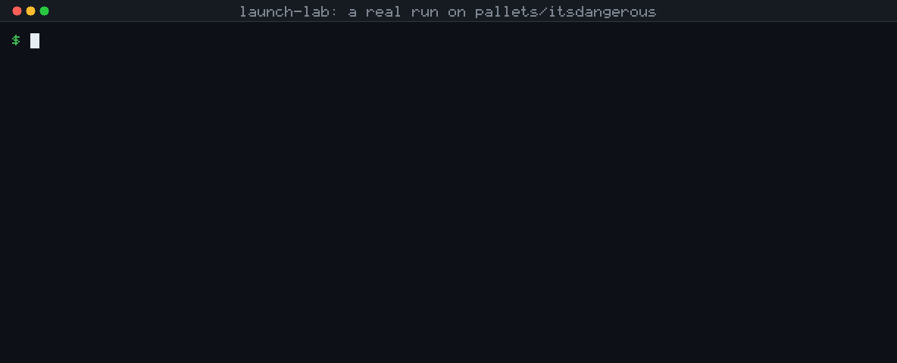
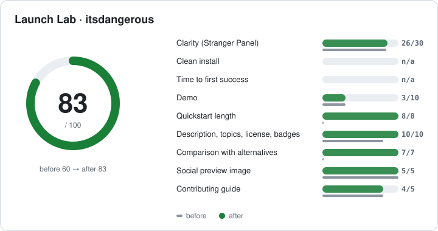
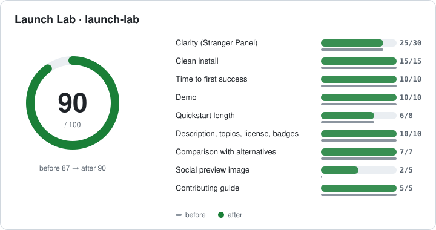

<h1 align="center">Launch Lab</h1>

<p align="center"><b>Other tools write your launch. Launch Lab tests whether it will work, before you post.</b></p>

<p align="center"><a href="LICENSE"></a> <a href="CHANGELOG.md"></a>  </p>

<p align="center"></p>

**What it does:** a Claude Code skill that shows your GitHub repo to three simulated first-time visitors (they see only the top of your README), runs your install steps exactly as written, and turns both into a 0-100 Star Readiness Score with the five fixes worth the most points. Then it tests again after you fix things.

**What it is not:** a star predictor. The score is a published, weighted checklist computed by plain Python (stdlib, 17 tests) plus the visitors' answers; only the visitors' reading uses Claude. **You need:** Claude Code. No API keys, no paid services. Your install commands run in Docker, or in a temp folder on your machine only after you approve the exact list.

Also included: demo GIFs, launch post drafts and post-launch star diagnosis.

## Install (10 seconds)

```
/plugin marketplace add likithtech2006-pixel/launch-lab
/plugin install launch-lab@launch-lab
```

Then open Claude Code in any repo and run `/launch-lab`. Without the plugin system, see [manual install](#manual-install).

### Manual install

```bash
git clone https://github.com/likithtech2006-pixel/launch-lab.git
mkdir -p ~/.claude/skills && cp -r launch-lab/skills/launch-lab ~/.claude/skills/
```

## Commands

| Command | What it does |
|---|---|
| `/launch-lab` | Full pipeline: panel → install test → score → fix loop → demo → posts |
| `/launch-lab panel` | Stranger Panel: 3+ persona subagents judge only the README's above-the-fold |
| `/launch-lab install` | Clean install test: follow only the README in Docker (or an isolated temp dir, with your OK) |
| `/launch-lab score` | Star Readiness Score with category breakdown and top 5 fixes |
| `/launch-lab demo` | Demo GIF for CLI, TUI, web app or library repos |
| `/launch-lab posts` | Drafts for Show HN, Reddit, X, LinkedIn, dev.to, Product Hunt and a 14-day calendar |
| `/launch-lab diagnose` | Post-launch: star conversion per period and referrer, and what to do next |

You can also just say "is my repo ready to launch?" or "why am I not getting stars?".

## Real example: pallets/itsdangerous

<p align="center"></p>

All three simulated visitors understood the library, and none would star it: the example stopped before
`loads()`, there was no install line, and nothing said whether data is signed or encrypted. One
rewrite of the top of the README took it from **60 to 83**. Fresh personas then showed that two
key sentences had landed just below the fold. [Full write-up, reports and raw persona answers →](examples/itsdangerous/)

## Launch Lab on itself

<p align="center"></p>

This README was run through Launch Lab before publishing: **87 → 90** after one round
([report](launch/report.md), [diff](launch/readme.round1.patch)). The install test passed 3/3 steps in an
isolated HOME. All 6 simulated visitors across both rounds described the project correctly, and none would
star it yet. Once the README was clear, their objection was the same every time: *show that this works on
real launches.* README edits can't fix that, so the loop stopped at round 1. Real launch data will
(`/launch-lab diagnose`). Running it on itself also found and fixed four bugs in the scanner (see the
[changelog](CHANGELOG.md)).

## How it works

1. **Scan.** Reads the README, manifests and source to find the above-the-fold text, repo type, install
   steps and launch signals (license, demo, comparison, topics, social preview).
2. **Stranger Panel.** Claude writes down what the repo *really* does from the full source first. Then
   each persona subagent sees only the first 25 lines and answers in JSON: what it does, who it is for,
   would you star it (with confidence), what confused you, what would make you star it. Answers are
   graded against the truth; a wrong purpose is a clarity failure. Add your own personas in
   `.launch-lab/config.json`.
3. **Clean install test.** Runs the README's install commands in a fresh Docker container. Without Docker,
   it shows you the command list and only runs it after you say yes, in a temp directory with its own
   HOME, venv and npm prefix and none of your API keys. Logs every friction point and time to first success.
4. **Score.** Nine weighted categories, documented in [`scoring.md`](skills/launch-lab/references/scoring.md):
   clarity 30, install 15, time to first success 10, demo 10, metadata 10, quickstart 8, comparison 7,
   social preview 5, contributing 5. Anything not measured is left out and the score is marked provisional.
5. **Fix and retest.** Proposes README edits as a diff, applies them only with your approval, re-runs the
   panel with new personas and shows before → after. Up to 3 rounds.
6. **Demo.** VHS for CLIs and TUIs, Playwright + ffmpeg for web apps, an animated code snippet for libraries,
   then a size ladder that keeps the GIF under GitHub's limit. A zero-dependency Python renderer is the
   fallback (it made the GIF above).
7. **Posts.** Drafts with tone rules: no hype words, no invented numbers, limitations stated, `[TODO]` for
   anything it cannot verify. Nothing is ever posted for you.
8. **Diagnose.** After launch, pulls views, visitors, referrers and star history with `gh` and tells you
   which pattern you are in: lots of traffic but few stars (README problem), few visitors who mostly star
   (reach problem), or a spike that went flat (nothing to come back for).

## How is this different?

| | Launch post writers¹ | Demo GIF makers² | **Launch Lab** |
|---|:---:|:---:|:---:|
| Writes launch posts | ✓ | | ✓ |
| Makes demo GIFs | | ✓ (some web-only) | ✓ CLI, TUI, web, library |
| Tests whether strangers understand the README | | | ✓ |
| Runs your install steps in a clean environment | | | ✓ |
| Score with ranked fixes, and re-tests after fixing | | | ✓ |
| Explains post-launch star conversion | | | ✓ |

¹ e.g. launch-kit, launch-post-writer, claude-skill-promote. ² e.g. demo-gif-skill, cli-demo-generator, animated-readme.
Based on how these projects describe themselves; if one does more, please open a PR to fix the table.
If you only need a quick post or a GIF, a single-purpose tool is simpler.

## Privacy and safety

- Runs locally. Your code goes only to your own Claude session; the only network calls are `gh` requests to your own repo.
- Writes only to `launch/` and `.launch-lab/`. README edits happen one diff at a time, after you approve.
- Never posts, publishes or pushes anything.
- README commands run in Docker, or on your machine only after you have seen the list and said yes.

## Requirements

- Claude Code (any plan). Python 3.9+. `gh` for metadata and post-launch diagnosis.
- Optional: Docker (install test), VHS, ffmpeg, Node + Playwright (richer demos), gifsicle.

## FAQ

**Is the score a prediction of how many stars I will get?** No. It is a checklist with weights,
plus simulated first impressions. Its value is the ranked fixes and the before/after change.

**Are simulated personas meaningful?** They catch the same things a cold reader does: vague taglines,
missing install lines, unanswered "why not X?". They are not real users; use them before you ask real people.

**How is this different from pasting my README into Claude?** Three things a chat review does not do:
each visitor sees *only* what a stranger sees before scrolling (and never your source), your install steps are
actually executed in a clean environment, and the result is a repeatable score with the same weights every run,
so you can compare before and after. The scanning, install test and scoring are plain Python; only the
visitors' reading and the grading against your repo's real purpose use Claude.

**Does it need Docker?** No. Without Docker you can approve a local run in an isolated temp directory, or use
static mode, which checks the instructions without running them.

**Which languages does it understand?** Detection covers Python, JavaScript/TypeScript, Rust, Go, shell scripts
and Claude skills. Other repos still get the panel, score and posts.

**Can I change the personas?** Yes: add personas in `.launch-lab/config.json` (see
[`personas.md`](skills/launch-lab/references/personas.md)).

**Does it cost anything?** No paid APIs. Persona subagents use your Claude Code session.

## Contributing

Issues and PRs are welcome; see [CONTRIBUTING.md](CONTRIBUTING.md). Run the tests with
`python3 -m unittest discover -s tests` (no dependencies). Evaluation scenarios are in [`evals/evals.json`](evals/evals.json).

## License

[MIT](LICENSE)
