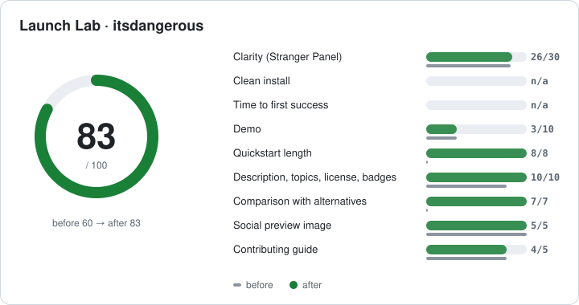

# Example: pallets/itsdangerous, before and after

A real Launch Lab run on [pallets/itsdangerous](https://github.com/pallets/itsdangerous)
(3.1k stars, maintained by Pallets, the Flask team). It was picked because it is a popular,
well-run project: the point is to show what a first-impression test finds even when the code is excellent.
Nothing was sent to or changed in the upstream repo. The "after" README is a proposal only.

<p align="center"></p>

| | Before | After round 1 |
|---|---:|---:|
| **Star Readiness Score** (provisional) | **60** | **83** |
| Personas who understood the purpose | 3 / 3 | 3 / 3 |
| Personas who would star it | 0 / 3 | 1 / 3 |
| Star intent (mean) | 40% | 45% |
| Install commands found | 0 | 1 (`pip install itsdangerous`) |

Both scores are **provisional**: Docker was not available on the machine that ran this, and
Launch Lab does not run third-party code on a host without Docker, so the clean install test ran
in static mode (it checks the instructions without running them) and the two install categories were excluded.

## What happened

**Round 0.** Three persona subagents (Skeptical HN developer, Beginner, Busy CTO) saw only the
first 25 lines of the README. All three described the library correctly: the body text is clear even
though the tagline (*"... so better sign this"*) is not. **None would star it.** Their reasons
overlapped:

- the example is cut off before `loads()`, so you never see verification (3 of 3)
- no install command (2 of 3)
- not stated whether the data is **signed or encrypted** (2 of 3)
- no comparison with JWT (2 of 3)
- no license, version or CI signal above the fold (3 of 3)

The score report ranked the fixes: quickstart (+8), demo (+7), comparison (+7).

**Fix.** [`readme.round1.patch`](readme.round1.patch) rewrites only the top of the README:
a plain tagline, four badges, `pip install` with the Python version, a complete
sign-and-verify example including the `BadSignature` case, a "signed, not encrypted" line and a
small "How is this different from JWT?" table. Everything from *Donate* down is unchanged.

**Round 1.** Three **new** persona subagents read the new fold. Understanding stayed perfect, nobody
mentioned the cut-off example or a missing install command any more, the beginner would now star it, and the score went from 60 to 83.

## The lesson the panel caught

All three personas *still* asked whether the data is signed or encrypted, and two still asked for a
JWT comparison. Both were in the new README, just **below the 25-line fold**: the badge block took four lines and pushed them down.
Without the panel, that would have looked done. Round 2 would put the badges on one line and
move the "signed, not encrypted" sentence directly under the example.

The remaining top fix is a demo. For a library, Launch Lab's pipeline records an animated
code-and-output snippet (`assets/snippet.html` + Playwright), and the output in it must come from
actually running the code.

## Files

| File | What |
|---|---|
| [`report-before.md`](report-before.md) / [`report-after.md`](report-after.md) | Full reports: categories, ranked fixes, every persona answer, install findings |
| [`score-card.svg`](score-card.svg) / [`score-card-before.svg`](score-card-before.svg) | Score cards (thin bars = before) |
| [`readme.round1.patch`](readme.round1.patch) | The proposed README change (unified diff) |
| `before/.launch-lab/`, `after/.launch-lab/` | Raw state: scan, panel (with truth, raw persona JSON and grades), static install result, score |

Regenerate the reports from the stored state:

```bash
python3 scripts/score.py examples/itsdangerous/before --round 0 --report examples/itsdangerous/report-before.md --svg examples/itsdangerous/score-card-before.svg
python3 scripts/score.py examples/itsdangerous/after --round 1 --before ../before/.launch-lab/score.round0.json \
  --report examples/itsdangerous/report-after.md --svg examples/itsdangerous/score-card.svg
```

Persona subagents ran on Claude Sonnet with the prompts produced by `scripts/panel.py prompts`.
Excerpts of the itsdangerous README in this folder (`scan.json`, the patch) are © Pallets,
BSD-3-Clause, and are reproduced for commentary.
